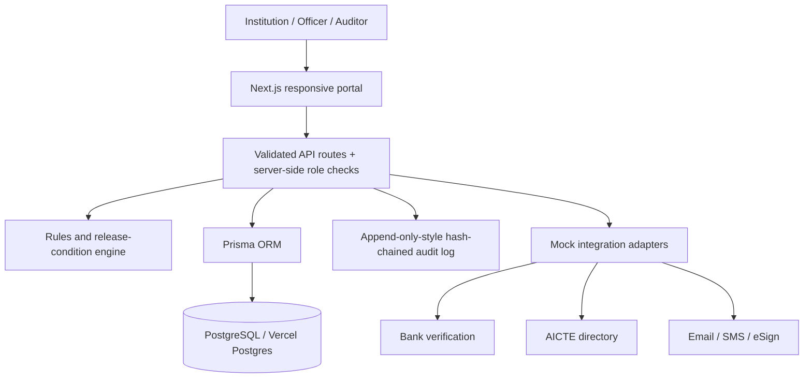

# FDR-Track — SIH26265

A demo-ready FDR / security deposit lifecycle management portal prototype for the AICTE Regulation Bureau. This is **not an official AICTE service**. All institutions, users, instruments, banks, amounts and events are synthetic.

---

## 🚀 Deploy to Vercel (Recommended)

### Prerequisites
- [Vercel account](https://vercel.com) (free tier works)
- Vercel Postgres database (created from your Vercel dashboard)

### Step-by-step

1. **Push to GitHub**: Upload this project to a GitHub repository.

2. **Import to Vercel**: Go to [vercel.com/new](https://vercel.com/new) → Import your repository.

3. **Create Vercel Postgres database**:
   - In your Vercel project dashboard → **Storage** → **Create Database** → choose **Postgres**.
   - Vercel will automatically inject `DATABASE_URL` and `POSTGRES_URL_NON_POOLING` into your project.

4. **Set environment variables** in Vercel project settings → Environment Variables:
   ```
   DATABASE_URL        = (auto-set by Vercel Postgres — use the pooled URL)
   DIRECT_URL          = (use POSTGRES_URL_NON_POOLING from Vercel Postgres)
   SESSION_SECRET      = (any random string ≥ 32 characters)
   DOCUMENT_ENCRYPTION_KEY = (64-character hex string)
   ```

5. **Run database migrations** (first time only):
   - In Vercel dashboard → your project → **Functions** tab, OR
   - Locally with your production DATABASE_URL:
     ```bash
     DATABASE_URL="<pooled-url>" DIRECT_URL="<non-pooled-url>" npx prisma db push
     ```

6. **Seed demo data** (optional):
   ```bash
   DATABASE_URL="<pooled-url>" DIRECT_URL="<non-pooled-url>" npm run db:seed
   ```

7. **Deploy**: Vercel builds and deploys automatically on every push.

---

## 💻 Run Locally (Node.js 20+)

1. Install Node.js 20 or newer.
2. Copy `.env.example` to `.env`:
   ```bash
   cp .env.example .env
   # Windows PowerShell:
   Copy-Item .env.example .env
   ```
3. For **local SQLite** (quickest):
   ```
   DATABASE_URL="file:./dev.db"
   DIRECT_URL="file:./dev.db"
   ```
4. Install packages:
   ```bash
   npm install
   ```
5. Prepare database and demo records:
   ```bash
   npx prisma db push && npm run db:seed
   ```
6. Start development server:
   ```bash
   npm run dev
   ```
   Open http://localhost:3000

### Demo Accounts (password: `Demo@12345`)

| Email | Role |
|---|---|
| institution@example.test | Institution User |
| scrutiny@example.test | Scrutiny Officer |
| authority@example.test | Competent Authority |
| auditor@example.test | Read-only Auditor |
| admin@example.test | System Admin |

> **Note**: The role switcher in the top-right is a demonstration convenience; it is **not production authentication**.

---

## What's Implemented

- Central repository, search and admin-status filtering; institution-scoped visibility for institution users.
- Separate date-derived validity and workflow status fields.
- Role-checked server routes for instrument creation, review actions and release decisions.
- Configurable-rule-shaped rules engine with R01, R02, R08, R09 and R11 starter checks; visible discrepancy records.
- Trust source tags (`INSTITUTION_DECLARED`, `DOCUMENT_EXTRACTED`, `BANK_CONFIRMED`) and a mock bank-verification adapter.
- Release workflow guardrails; approval is not automatic and final decision is restricted to Competent Authority / Admin.
- Audit log with SHA-256 hash chaining and a verification endpoint.
- Seeded synthetic records and users; dashboard KPIs; test cases for core rule/date/reminder/release logic.
- Responsive neutral government-portal-style UI and integration status page.

## Real vs Simulated

| Capability | Prototype Status |
|---|---|
| Institution directory | Synthetic local seed data; real AICTE integration not connected |
| Bank verification | Mock outcome only; not a real bank check |
| OCR / document extraction | Schema and adapter-facing fields are present; upload/OCR UI is not yet wired |
| Email and SMS reminders | Not sent; scheduler/outbox integration remains to be connected |
| Date simulation | UI demonstrates intent only; it does not alter server clock in this build |
| FDR document encryption/storage | Schema has encrypted-storage path and hash fields; secure upload/storage pipeline is not yet implemented |
| Renewal lineage | Database relations and sample lineage seeded; guided renewal-link UI not yet wired |
| PDF/CSV reports | Not implemented in this build |
| Impact measurements | Current counts shown; baseline entry is illustrative and not yet persisted/calculated |
| Authentication | Demo role switcher; production login, hardened sessions, MFA and rate limiting required |
| Audit chain | SHA-256 hash chaining and verification endpoint; database administrators could still alter all records, so this is tamper-evident, not immutable |

## Architecture



## Assumptions and Safety

- Required amount and tenure are **illustrative seed values only**. Confirm current AICTE Approval Process Handbook and applicable rules before any real deployment.
- Government institution exemptions are represented in the data model but the end-to-end exemption rule is not yet wired.
- OCR findings should be treated as leads for scrutiny, never as definitive fraud conclusions.
- No release is automatically approved.
- Never upload genuine financial documents or use real personal data in this demo.
- Use PostgreSQL, secure cookies, hardened authentication, encrypted object storage, key management, observability, rate limiting, CSRF protections and security review before production.

## Tests

Run `npm test`. Core rules tests cover date validity, rule findings, reminder offsets and release conditions.

## Known Limitations

This is an initial full-stack prototype, not a finished regulated production system. The remaining high-priority work is document upload + actual encryption and OCR, persisted simulated clock/scheduler and reminder outbox, full configurable rules UI, discrepancy response flow, complete lineage creation UI, CSV/PDF exports, persistent impact baselines, comprehensive e2e tests, and production-grade authentication/security. The UI intentionally labels integrations as simulated rather than implying external verification.
